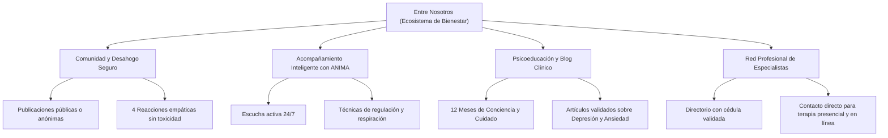
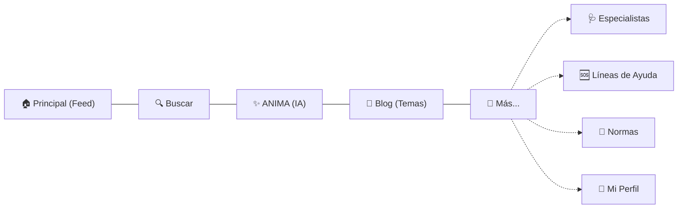
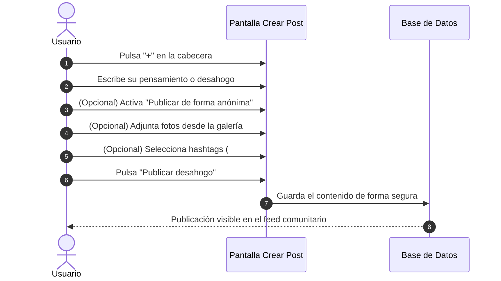

# Entre Nosotros — Descripción del Proyecto y Manual de Usuario

---

# PARTE I: DESCRIPCIÓN DEL PROYECTO

## 1. ¿Qué es Entre Nosotros?
**Entre Nosotros** es una plataforma y aplicación móvil/web de bienestar emocional y salud mental diseñada para brindar un entorno seguro, confidencial, empático y libre de juicios. Su objetivo fundamental es conectar a personas que atraviesan momentos difíciles, soledad, ansiedad, tristeza o procesos de crecimiento personal con una comunidad de apoyo mutuo y con profesionales de la psicología clínica colegiados.

A diferencia de las redes sociales convencionales orientadas a métricas de vanidad o algoritmos que promueven la confrontación, Entre Nosotros prioriza la **vulnerabilidad positiva**, la **validación emocional** y la **construcción de redes de cuidado mutuo**.

---

## 2. Pilares y Filosofía de la Plataforma

1. **Empatía sin Juicios**: Cada miembro puede expresarse libremente sabiendo que encontrará respeto, anonimato si lo requiere y palabras de aliento.
2. **Reacciones con Propósito**: No existen "Me gusta" genéricos; las interacciones se basan en 4 respuestas de empatía genuina: *Te Abrazo*, *Te Escucho*, *No Estás Solo* y *Fuerza*.
3. **ANIMA, Compañero Emocional**: Un asistente conversacional con inteligencia artificial disponible 24/7 para ejercicios de respiración, desahogos guiados y contención primaria.
4. **Soporte Clínico Real**: Artículos psicoeducativos redactados por psicólogos profesionales y un directorio directo para solicitar terapia formal.
5. **Autoconocimiento Diario**: Monitoreo de estado de ánimo (*Daily Mood*), test de dimensiones emocionales y desafíos de bienestar de 7 días.

---

## 3. Identidad Visual y Experiencia de Usuario
- **Paleta de Colores**: Diseñada con tonalidades suaves y tranquilizantes en **Blanco y Azul Cielo Pastel** (`#FFFFFF`, `#F0F5F8`, `#E1EAEF`, `#3B708F`), reduciendo la sobreestimulación visual.
- **Tipografía Limpia**: Textos legibles y espacios amplios adaptados para lectura cómoda en cualquier condición de iluminación.
- **Multiplataforma**: Funcionalidad completa y sincronizada tanto en teléfonos móviles (iOS / Android mediante Expo) como en navegadores web de escritorio y móviles.

---

# PARTE II: MANUAL COMPLETO DE USUARIO

Bienvenido a la guía oficial de **Entre Nosotros**. A continuación encontrarás el funcionamiento detallado de cada una de las herramientas, pantallas e interacciones disponibles para ti.

---

## ÍNDICE DEL MANUAL
1. [Acceso, Registro y Gestión de Cuenta](#1-acceso-registro-y-gestión-de-cuenta)
2. [Estructura y Navegación de la App](#2-estructura-y-navegación-de-la-app)
3. [Pantalla Principal (Muro de la Comunidad)](#3-pantalla-principal-muro-de-la-comunidad)
4. [Cómo Crear y Compartir un Desahogo](#4-cómo-crear-y-compartir-un-desahogo)
5. [ANIMA: Tu Compañero Emocional 24/7](#5-anima-tu-compañero-emocional-247)
6. [Blog de Salud Mental y Calendario de Conciencia](#6-blog-de-salud-mental-y-calendario-de-conciencia)
7. [Directorio de Psicólogos y Especialistas](#7-directorio-de-psicólogos-y-especialistas)
8. [Centro de Apoyo, Test Emocional y Retos de Racha](#8-centro-de-apoyo-test-emocional-y-retos-de-racha)
9. [Buscador y Exploración de Temas](#9-buscador-y-exploración-de-temas)
10. [Tu Perfil Personal y Monitoreo Emocional](#10-tu-perfil-personal-y-monitoreo-emocional)
11. [Reglas de Convivencia y Seguridad Comunitaria](#11-reglas-de-convivencia-y-seguridad-comunitaria)

---

## 1. Acceso, Registro y Gestión de Cuenta

### Modo Invitado vs. Cuenta Registrada
- **Modo Invitado**: Al abrir la aplicación sin iniciar sesión, puedes leer libremente las publicaciones del muro, explorar el calendario del blog, consultar los artículos de especialistas y revisar las líneas de ayuda de emergencia.
- **Cuenta Registrada**: Al registrarte de forma gratuita, desbloqueas:
  - Crear tus propios desahogos (públicos o 100% anónimos).
  - Reaccionar con apoyo emocional a otros miembros.
  - Dejar comentarios en las publicaciones.
  - Guardar publicaciones y artículos en tus marcadores personales.
  - Registrar tu estado de ánimo diario y consultar tu gráfica semanal.
  - Realizar el test psicológico y activar desafíos de racha.
  - Conversar en privado con ANIMA.

### Cómo Crear una Cuenta
1. En la parte superior derecha de la pantalla, pulsa el botón **"Unirme"** (o cuando intentes realizar una acción protegida).
2. Selecciona la pestaña **"Crear Cuenta"**.
3. Ingresa:
   - **Nombre de Usuario**: Tu apodo visible (ej. `@esperanza_viva`).
   - **Correo Electrónico**: Para validación y recuperación de contraseña.
   - **Contraseña**: Mínimo 6 caracteres.
4. Consulta y acepta los **Términos y Condiciones** de la plataforma.
5. Pulsa **"Crear Cuenta"**. Tu sesión se iniciará de forma automática.

### Recuperación de Contraseña
Si olvidaste tu clave de acceso:
1. En la ventana de inicio de sesión, pulsa **"¿Olvidaste tu contraseña?"**.
2. Escribe tu correo electrónico registrado.
3. Se te enviará un enlace seguro para restablecerla de inmediato.

---

## 2. Estructura y Navegación de la App

La aplicación cuenta con una navegación intuitiva accesible en todo momento:

- **Barra Inferior (Bottom Tab Bar)**:
  - **Principal**: El muro vivo de la comunidad y tu registro diario de ánimo.
  - **Buscar**: Explorador de publicaciones, palabras clave y hashtags.
  - **ANIMA**: Acompañante con inteligencia artificial y ejercicios de relajación.
  - **Blog**: Calendario temático de 12 meses y artículos clínicos de especialistas.
  - **Más...**: Menú emergente para acceder a Psicólogos, Ayuda de Crisis, Reglas y Perfil.
- **Barra Superior (AppHeader)**:
  - Logotipo oficial de **Entre Nosotros**.
  - Botón **"+" (Crear Publicación)**: Acceso directo para redactar un desahogo.
  - **Avatar / Foto de Perfil**: Acceso a tu perfil personal o botón "Unirme".
- **Menú Lateral (Drawer)**:
  - Deslizable desde la izquierda mediante el icono de menú, ofreciendo atajos a cada módulo de la aplicación.

---

## 3. Pantalla Principal (Muro de la Comunidad)

Al ingresar a la app, te encontrarás en el corazón de Entre Nosotros:

### A. Registro Diario de Estado de Ánimo (*Daily Mood Card*)
- **¿Qué es?**: Un módulo interactivo ubicado al inicio del muro donde puedes responder a la pregunta: *¿Cómo te sientes hoy?*.
- **Opciones de Ánimo**:
  - 🤩 **Increíble**: Llena de energía y gratitud.
  - 😊 **Bien**: En paz y tranquilidad.
  - 😐 **Neutral**: Un día ordinario o en calma.
  - 😔 **Desanimado**: Cansancio emocional o tristeza leve.
  - 😢 **Mal**: Dolor emocional, agobio o momento difícil.
- **Respuesta Empática**: Al pulsar una emoción, el sistema guarda tu registro del día y te presenta una reflexión cálida y respetuosa adaptada a cómo te sientes.
- **Gráfica Semanal**: Cada registro alimenta tu historial visible en tu perfil para que puedas observar tus variaciones de ánimo con el tiempo.

### B. Frase Inspiracional del Día (*Daily Quote Card*)
Una tarjeta visual con citas motivacionales, reflexiones de autocuidado y recordatorios de que cada emoción es válida y transitoria.

### C. Muro de Desahogos y Publicaciones
El flujo continuo de historias compartidas por los miembros:
- **Identidad**: Puedes ver publicaciones con nombre de usuario de quien las escribió o marcadas como **Anónimo** (para proteger la privacidad de temas sensibles).
- **Publicaciones de Especialistas**: Los psicólogos colegiados aparecen con una insignia distintiva verde o azul de **"Psicólogo Oficial"**, destacando consejos profesionales.
- **Contenido Multimedia**: Fotografías de paisajes, arte o momentos que complementan los relatos.
- **Hashtags Interactivos**: Etiquetas temáticas (ej. `#Ansiedad`, `#Duelo`, `#Gratitud`) que puedes pulsar para filtrar historias similares.

### D. El Sistema de Reacciones de Apoyo
En lugar de "likes", Entre Nosotros cuenta con **4 reacciones empáticas**:

| Reacción | Icono | Significado Emocional |
| :--- | :---: | :--- |
| **Te Abrazo** | 🤗 *(Corazón / Abrazo)* | Para brindar calidez y contención a quien sufre. |
| **Te Escucho** | 👂 *(Escucha atenta)* | Para validar que su desahogo ha sido leído y comprendido. |
| **No Estás Solo** | 🤝 *(Manos unidas)* | Para recordar que compartimos las mismas luchas humanas. |
| **Fuerza** | 💪 *(Rayo / Energía)* | Para enviar ánimo y fortaleza ante los desafíos cotidianos. |

- **Cómo reaccionar**:
  - Pulsa una vez el botón de reaccionar para enviar la reacción por defecto (*Te Abrazo*).
  - Mantén presionado el botón por medio segundo para que aparezca el selector flotante y elijas cualquiera de las 4 opciones.
  - Para retirar tu reacción, vuelve a pulsar la reacción activa.

### E. Comentarios y Guardado
- **Dejar unas palabras**: Pulsa el botón de comentario para leer las respuestas de otros usuarios y dejar un mensaje de apoyo sincero.
- **Guardar**: Pulsa el icono de marcador para guardar el post en tu biblioteca personal privada.

---

## 4. Cómo Crear y Compartir un Desahogo

Compartir lo que sientes alivia la carga emocional. Para publicar:

1. **Abrir el editor**: Pulsa el botón **"+"** en la cabecera superior.
2. **Escribir tu mensaje**: Expresa libremente tus pensamientos, dudas, reflexiones o momentos difíciles.
3. **Modalidad Anónima**:
   - Activa el interruptor **"Publicar de forma anónima"** si prefieres que tu nombre de usuario y avatar queden totalmente ocultos. Tu identidad estará 100% protegida.
4. **Agregar Fotos**:
   - Pulsa el icono de imagen para adjuntar fotografías de tu galería que ilustren tu estado o mensaje.
5. **Hashtags Temáticos**:
   - Agrega etiquetas relevantes para que personas que pasen por lo mismo encuentren tu desahogo.
6. **Publicar**:
   - Pulsa el botón principal para compartir. Tu publicación aparecerá de inmediato en el muro comunitario.

---

## 5. ANIMA: Tu Compañero Emocional 24/7

**ANIMA** es la inteligencia artificial de acompañamiento de Entre Nosotros. No busca sustituir la terapia humana, sino ser un refugio de escucha y calma accesible en cualquier momento del día o de la noche.

### Capacidades de ANIMA
- **Escucha Incondicional**: Puedes contarle tus preocupaciones, miedos o alegrías en un chat privado y confidencial.
- **Ejercicios de Respiración y Relajación**: Solicítale guías de respiración (como la técnica 4-7-8) para reducir episodios de ansiedad.
- **Respuestas Empáticas y Positivas**: Mensajes estructurados para ayudarte a reformular pensamientos rumiantes o negativos.

### Atajos de Conversación Rápida
En la parte inferior de la pantalla de ANIMA encontrarás botones rápidos:
- 🌧️ *Tengo ansiedad*
- 💬 *Necesito hablar*
- 🧘‍♂️ *Ejercicio de respiración*
- ✨ *Consejo positivo*
- 💤 *No puedo dormir*
- 🌱 *Me siento triste*
- 🎯 *Autoestima*
- 💙 *Manejo de estrés*

### Protocolo de Detección de Crisis
> [!IMPORTANT]
> Si en la conversación ANIMA detecta señales de riesgo severo o pensamientos autolesivos, activará de forma prioritaria el **Banner de Crisis Emocional**, ofreciéndote un botón de llamada directa y gratuita a las líneas nacionales de atención psicológica especializada (disponibles las 24 horas).

---

## 6. Blog de Salud Mental y Calendario de Conciencia

La pestaña **Blog** combina la psicoeducación profesional con una guía anual de bienestar:

### A. Calendario de Conciencia y Cuidado (12 Meses)
Un carrusel interactivo que dedica cada mes del año a un tema de salud mental:
- **Enero**: *Nuevos Comienzos y Gratitud*
- **Febrero**: *Amor Propio y Relaciones Sanas*
- **Marzo**: *Resiliencia y Gestión Emocional*
- **Abril**: *Salud Mental en la Infancia y Adolescencia*
- **Mayo**: *Mes Mundial de la Salud Mental*
- **Junio**: *Diversidad, Identidad y Aceptación*
- **Julio**: *Autocuidado y Descanso Consciente*
- **Agosto**: *Prevención del Burnout y Estrés Laboral*
- **Septiembre**: *Conciencia y Prevención del Suicidio*
- **Octubre**: *Psicoeducación y Derribando Estigmas*
- **Noviembre**: *Duelo, Pérdida y Acompañamiento*
- **Diciembre**: *Cierre de Ciclos y Esperanza*

> **Cómo explorarlo**: Desliza horizontalmente por las tarjetas. Al pulsar sobre cualquier mes, se despliega una ventana completa con el lema del mes, herramientas prácticas y lecturas sugeridas.

### B. Temas que te pueden interesar (Artículos Clínicos de Especialistas)
En el blog encontrarás dos secciones oficiales:
1. **Depresión**
2. **Ansiedad**

#### Cómo interactuar con los temas:
- Pulsa sobre la tarjeta de **Depresión** o **Ansiedad**.
- Se abrirá la pantalla completa del tema con su fotografía panorámica oficial.
- **Artículos de Psicólogos**: Podrás leer artículos, guías y herramientas redactadas exclusivamente por especialistas clínicos verificados.
- **Ver Perfil del Especialista**: Al pulsar sobre el nombre o foto del psicólogo en el artículo, puedes consultar su cédula, experiencia y solicitar consulta.
- **Reaccionar y Guardar**: Puedes otorgar reacciones de empatía al artículo o guardarlo en tus marcadores para volver a consultarlo cuando lo necesites.
- *(Por seguridad y rigor clínico, en estos artículos no hay comentarios abiertos, garantizando una lectura serena).*

---

## 7. Directorio de Psicólogos y Especialistas

Entre Nosotros facilita el puente entre la comunidad y la atención profesional:

### Cómo buscar un especialista:
1. Abre el menú **"Más..."** y selecciona **"Especialistas"**.
2. Filtra por:
   - **Especialidad**: Depresión, Ansiedad, Terapia de Pareja, Tanatología, etc.
   - **Modalidad**: En línea, Presencial o Ambas.
   - **Búsqueda por texto**: Nombre, ciudad o clínica.

### Ficha Detallada del Psicólogo:
Al pulsar sobre cualquier especialista accederás a:
- **Nombre y Fotografía oficial**.
- **Cédula Profesional validada**.
- **Enfoque Terapéutico y Especialidades**.
- **Biografía profesional**.
- **Ubicación**: Dirección y botón de enlace directo para ver en mapa.
- **Botón de Contacto Directo**: Enlace para enviar un mensaje directo de **WhatsApp** o realizar una llamada telefónica para agendar tu primera cita.

---

## 8. Centro de Apoyo, Test Emocional y Retos de Racha

En el módulo **Ayuda y Soporte** (accesible desde el menú *Más...*):

### A. Líneas de Atención Telefónica Inmediata 24/7
Información oficial de emergencia gratuita y confidencial en México:
- **Línea de la Vida**: `800 911 2000` (Atención nacional 24 horas en crisis y prevención del suicidio).
- **SAPTEL**: `55 5259 8121` (Servicio de apoyo psicológico por teléfono).
- Botones de marcación rápida para llamar con un solo toque desde tu celular.

### B. Test Psicológico Interactivo
- Una autoevaluación guiada en preguntas con escala sencilla (*Casi nunca*, *A veces*, *Seguido*, *Mucho hoy*).
- Evalúa dimensiones clave:
  1. Ánimo y Alegría
  2. Ansiedad y Calma
  3. Sueño y Energía
  4. Red de Apoyo y Relaciones
- Al concluir, recibes un **diagnóstico empático** con recomendaciones personalizadas.

### C. Reto Emocional de 7 Días (*Streaks*)
- Basado en los resultados de tu test, puedes activar un **Desafío de Bienestar de 7 Días**.
- Cada día desbloquearás una pequeña tarea alcanzable (ej. realizar 5 minutos de caminata consciente, escribir 3 agradecimientos, beber agua y desconectarte 15 minutos).
- Conforme avanzas, mantienes tu contador de racha y desbloqueas insignias conmemorativas.

---

## 9. Buscador y Exploración de Temas

En la pestaña **Buscar**:
- **Buscador en Tiempo Real**: Escribe cualquier palabra clave (ej. *"soledad"*, *"trabajo"*, *"esperanza"*) para encontrar reflexiones afines.
- **Hashtags en Tendencia**: Explora los temas de conversación más activos de la comunidad.
- **Exploración por Autor**: Localiza publicaciones compartidas por un miembro específico mediante `@nombre_de_usuario`.

---

## 10. Tu Perfil Personal y Monitoreo Emocional

Al pulsar en tu avatar:
- **Información Personal**: Muestra tu nombre de usuario, biografía y fecha de unión a la plataforma.
- **Personalización de Avatar**: Elige el avatar que mejor exprese tu personalidad entre diversas ilustraciones.
- **Rastreador Semanal de Estado de Ánimo**: Una visualización de cómo te has sentido en los últimos 7 días.
- **Pestaña "Mis Publicaciones"**: Historial de todos los desahogos que has compartido, con sus reacciones y comentarios.
- **Pestaña "Guardados"**: Tu colección privada de publicaciones y artículos que decidiste marcar como favoritos.
- **Red de Apoyo**: Consulta a quiénes sigues y quiénes te siguen para mantenerte al tanto de sus relatos.
- **Cerrar Sesión**: Opción segura para salir de tu cuenta en dispositivos compartidos.

---

## 11. Reglas de Convivencia y Seguridad Comunitaria

Entre Nosotros mantiene tolerancia cero a comportamientos dañinos. Al formar parte de la comunidad, te comprometes a seguir nuestro código de convivencia:

> [!CAUTION]
> ### Normas de Obligatorio Cumplimiento:
> 1. **Cero Tolerancia al Odio y Acoso**: Quedan estrictamente prohibidos los insultos, discriminación por género, orientación, origen, religión o condición de salud.
> 2. **Espacio Libre de Burlas**: La vulnerabilidad es sagrada. Ningún desahogo debe ser objeto de crítica destructiva o burla.
> 3. **Prohibido Promover Autolesiones**: Cualquier incitación o apología a dañarse a uno mismo será retirada inmediatamente y reportada.
> 4. **Respeto a la Privacidad**: No compartas datos personales ajenos (teléfonos, direcciones o nombres reales sin consentimiento).
> 5. **Publicidad No Autorizada**: Está prohibido el spam, venta de productos o promociones comerciales no avaladas.

### Cómo Reportar Contenido
Si observas una publicación que infrinja estas reglas:
1. Pulsa el botón de los tres puntos **"..."** en la esquina superior de la publicación.
2. Selecciona **"Reportar publicación"**.
3. El contenido entrará en revisión prioritaria por el equipo de moderación.

---

*Entre Nosotros — Porque ninguna tormenta emocional se debe atravesar en soledad.*
