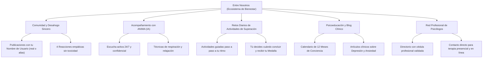
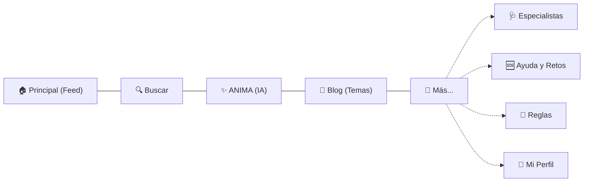
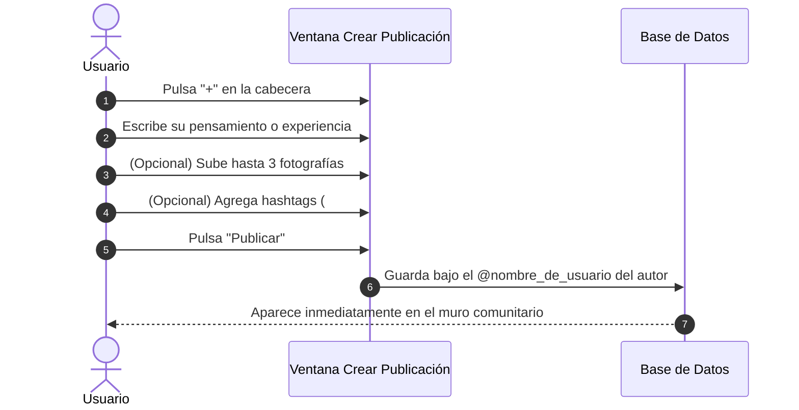
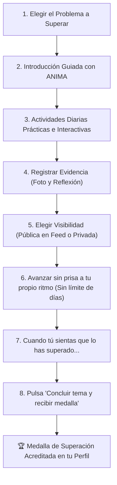

# Entre Nosotros — Descripción del Proyecto y Manual de Usuario

---

# PARTE I: DESCRIPCIÓN DEL PROYECTO

## 1. ¿Qué es Entre Nosotros?
**Entre Nosotros** es una plataforma y aplicación móvil/web de bienestar emocional y salud mental creada para brindar un entorno digital cálido, seguro, empático y libre de juicios. Su misión fundamental es acompañar a las personas en momentos difíciles de su vida —como la depresión, la ansiedad, el estrés o la falta de amor propio—, facilitando una comunidad de soporte mutuo, dinámicas de actividades diarias para superar problemas emocionales y el acceso directo a psicólogos clínicos colegiados.

En Entre Nosotros no existen algoritmos de confrontación ni métricas de vanidad. Todo el diseño y las funciones están orientados a **la validación de lo que sientes, la superación personal a tu propio ritmo y el acompañamiento constante.**

---

## 2. Pilares Fundamentales del Ecosistema

1. **Privacidad Basada en tu Nombre de Usuario**: Tú decides cómo identificarte en la comunidad. Al registrarte eliges tu `@nombre_de_usuario`, el cual puede ser tu nombre real o un seudónimo protector. Todas tus publicaciones y comentarios se muestran bajo ese nombre.
2. **Reacciones Empáticas con Significado Real**: Se sustituyeron los "likes" por 4 expresiones de apoyo genuino: *Te Abrazo*, *Te Escucho*, *No Estás Solo* y *Fuerza*.
3. **Retos Diarios para Superar tu Problema**: Actividades prácticas y sensoriales guiadas por ANIMA en 4 áreas clave (**Depresión**, **Ansiedad**, **Estrés** y **Amor Propio**). Avanzas a tu ritmo y, cuando sientas que has superado esa etapa, concluyes para recibir tu **Medalla de Superación** oficial.
4. **ANIMA, Asistente Emocional 24/7**: Inteligencia artificial de contención primaria entrenada para escuchar, guiar ejercicios de relajación y activar protocolos de seguridad ante emergencias.
5. **Vínculo con Especialistas Reales**: Artículos de divulgación clínica redactados por profesionales y acceso directo a psicólogos con cédula profesional verificada.

---

## 3. Identidad Visual y Experiencia
- **Colores Oficiales**: Una paleta serena y moderna basada en **Blanco y Azul Cielo Pastel** (`#FFFFFF`, `#F0F5F8`, `#E1EAEF`, `#3B708F`, `#223E52`), reduciendo la ansiedad visual.
- **Tipografía y Proporciones Humanas**: Espacios generosos, botones claros y tarjetas limpias diseñadas para una lectura cómoda.
- **Multiplataforma**: Totalmente sincronizada tanto en dispositivos móviles (iOS y Android vía Expo) como en computadoras de escritorio y navegadores web.

---

# PARTE II: MANUAL COMPLETO DE USUARIO

Bienvenido/a a la guía oficial de **Entre Nosotros**. A continuación te explicamos detalladamente cada módulo, pantalla, botón e interacción de la aplicación.

---

## ÍNDICE DEL MANUAL
1. [Acceso, Registro y Tu Nombre de Usuario](#1-acceso-registro-y-tu-nombre-de-usuario)
2. [Estructura de Pantallas y Navegación](#2-estructura-de-pantallas-y-navegación)
3. [Pantalla Principal (Muro Comunitario)](#3-pantalla-principal-muro-comunitario)
4. [Cómo Crear y Compartir una Publicación](#4-cómo-crear-y-compartir-una-publicación)
5. [ANIMA: Tu Refugio de Escucha y Calma](#5-anima-tu-refugio-de-escucha-y-calma)
6. [Reto de Actividades Diarias para Superar tu Problema](#6-reto-de-actividades-diarias-para-superar-tu-problema)
7. [Blog: Calendario de 12 Meses y Artículos de Especialistas](#7-blog-calendario-de-12-meses-y-artículos-de-especialistas)
8. [Directorio de Especialistas Clínicos](#8-directorio-de-especialistas-clínicos)
9. [Buscador Inteligente y Exploración por Temas](#9-buscador-inteligente-y-exploración-por-temas)
10. [Tu Perfil Personal, Registro de Ánimo y Medallas](#10-tu-perfil-personal-registro-de-ánimo-y-medallas)
11. [Seguridad Comunitaria y Líneas de Emergencia 24/7](#11-seguridad-comunitaria-y-líneas-de-emergencia-247)

---

## 1. Acceso, Registro y Tu Nombre de Usuario

### Modo Invitado vs. Usuario Registrado
- **Modo Invitado (Sin Cuenta)**: Al abrir la app puedes explorar el muro comunitario, leer los artículos del blog, ver los 12 meses de conciencia, consultar el directorio de psicólogos y acceder a los números de emergencia.
- **Cuenta Registrada (Gratuita)**: Al registrarte desbloqueas toda la experiencia interactiva:
  - Crear publicaciones y desahogos en el muro.
  - Reaccionar con apoyo a otros miembros.
  - Comentar en las historias de la comunidad.
  - Guardar publicaciones y artículos en tus marcadores personales.
  - Registrar tu estado de ánimo diario (*Daily Mood*) y ver tu gráfica semanal.
  - Iniciar tu Reto de Actividades Diarias de Superación y ganar medallas.
  - Conversar en privado con ANIMA.

### Cómo Funciona tu Identidad y Nombre de Usuario
> [!NOTE]
> En Entre Nosotros **todas las publicaciones se realizan bajo tu nombre de usuario**. 
> - Al crear tu cuenta tú decides qué colocar: puedes usar tu **nombre real** (ej. `@carlos_mendoza`) o un **seudónimo / alias** (ej. `@luz_de_otono`, `@caminante_azul`) si deseas proteger tu privacidad personal frente a conocidos.
> - La comunidad siempre verá ese identificador junto con tu avatar.

### Registro Paso a Paso
1. En la parte superior derecha de la pantalla, pulsa el botón **"Unirme"**.
2. Selecciona la pestaña **"Crear Cuenta"**.
3. Completa los campos:
   - **Nombre de Usuario**: El nombre o alias con el que te conocerá la comunidad (ej. `@renacer_hoy`).
   - **Correo Electrónico**: Para respaldar tu cuenta y recuperar tu acceso.
   - **Contraseña**: Mínimo 6 caracteres.
4. Consulta y acepta los Términos y Condiciones.
5. Pulsa **"Crear Cuenta"** y tu sesión se iniciará de inmediato.

### Recuperación de Contraseña
Si olvidas tu contraseña:
1. En la ventana de inicio de sesión, pulsa **"¿Olvidaste tu contraseña?"**.
2. Escribe tu correo electrónico y recibirás un enlace seguro para restablecerla.

---

## 2. Estructura de Pantallas y Navegación

La plataforma cuenta con un sistema de navegación claro y fluido:

- **Barra de Pestañas Inferior (Bottom Tab Bar)**:
  - **Principal**: Muro de la comunidad, registro de ánimo diario y frase inspiracional.
  - **Buscar**: Explorador de publicaciones por palabras clave y hashtags.
  - **ANIMA**: Chat inteligente de compañía emocional y ejercicios de respiración.
  - **Blog**: Calendario temático de 12 meses y artículos clínicos de especialistas.
  - **Más...**: Menú emergente para acceder a Especialistas, Ayuda y Retos, Reglas y Perfil.
- **Cabecera Superior (AppHeader)**:
  - Logotipo oficial de Entre Nosotros.
  - Botón **"+" (Crear Publicación)** para compartir un pensamiento rápidamente.
  - Avatar personal para ingresar directamente a tu perfil.
- **Menú Lateral (Drawer)**:
  - Desplegable desde el icono de menú para acceder a todas las secciones.

---

## 3. Pantalla Principal (Muro Comunitario)

Es el espacio central de conexión y empatía:

### A. Registro Diario de Estado de Ánimo (*Daily Mood Card*)
Al inicio del muro verás la pregunta: *¿Cómo te sientes hoy?*.
- **Opciones disponibles**:
  - 🤩 **Increíble**: Plenitud y alta energía.
  - 😊 **Bien**: Calma, tranquilidad y balance.
  - 😐 **Neutral**: Un día ordinario, sin emociones intensas.
  - 😔 **Desanimado**: Desgaste leve, tristeza o falta de motivación.
  - 😢 **Mal**: Agobio profundo, dolor emocional o crisis.
- **Mensaje Empático**: Tras pulsar tu emoción, la aplicación te presenta una respuesta cálida y personalizada que valida lo que sientes.
- **Historial Semanal**: Tu selección alimenta la gráfica de monitoreo semanal visible en tu perfil personal.

### B. Frase Inspiracional del Día (*Daily Quote Card*)
Una tarjeta visual diaria con mensajes reflexivos sobre autocuidado, aceptación y resiliencia.

### C. Muro de Publicaciones
El flujo continuo de historias y reflexiones de la comunidad:
- **Tu Nombre de Usuario en Cada Publicación**: Cada relato muestra el avatar y el nombre de usuario de su autor.
- **Insignia de Psicólogo**: Los psicólogos colegiados aparecen con una insignia verificada de **"Psicólogo Oficial"**, destacando recomendaciones clínicas.
- **Fotografías**: Imágenes que los usuarios adjuntan para ilustrar sus momentos.
- **Hashtags Clickeables**: Etiquetas como `#Desahogo`, `#Superación` o `#Ansiedad` para encontrar publicaciones afines.

### D. Sistema Oficial de las 4 Reacciones de Apoyo
En Entre Nosotros las reacciones expresan empatía genuina:

| Reacción | Icono | Significado Emocional |
| :--- | :---: | :--- |
| **Te Abrazo** | 🤗 *(Corazón / Abrazo)* | Para arropar y brindar calidez en momentos difíciles. |
| **Te Escucho** | 👂 *(Escucha atenta)* | Para validar que su desahogo ha sido leído y respetado. |
| **No Estás Solo** | 🤝 *(Manos unidas)* | Para recordar que compartimos las mismas luchas humanas. |
| **Fuerza** | 💪 *(Rayo / Energía)* | Para enviar ánimo y perseverancia ante los retos. |

- **Cómo reaccionar**:
  - Pulsa una vez para otorgar la reacción rápida (*Te Abrazo*).
  - Mantén presionado el botón por medio segundo para desplegar el selector y elegir entre las 4 opciones.
  - Si vuelves a presionar la reacción activa, se retira de la publicación.

### E. Comentarios y Guardado
- **Dejar unas palabras**: Pulsa el botón de comentario para enviar un mensaje de aliento respetuoso.
- **Guardar**: Pulsa el icono de marcador para archivar la publicación en tu lista privada de guardados.

---

## 4. Cómo Crear y Compartir una Publicación

Compartir lo que cargas dentro reduce el peso del malestar emocional:

1. **Abrir el editor**: Pulsa el botón **"+"** en la cabecera superior.
2. **Escribir tu mensaje**: Expresa libremente tus vivencias, reflexiones o momentos difíciles.
3. **Adjuntar Fotos (Hasta 3 imágenes)**:
   - Cuentas con 3 casillas interactivas para elegir fotografías de tu galería.
   - Puedes eliminar o cambiar cualquier fotografía antes de publicar.
4. **Hashtags Temáticos**:
   - Escribe etiquetas o pulsa sobre los hashtags populares para categorizar tu publicación.
5. **Publicar**:
   - Pulsa el botón principal. Tu relato se publicará de inmediato mostrando tu `@nombre_de_usuario` y avatar.

---

## 5. ANIMA: Tu Refugio de Escucha y Calma

**ANIMA** es el asistente de inteligencia artificial de Entre Nosotros. Diseñado para ofrecer escucha incondicional, compañía constante y herramientas de autorregulación.

### ¿Qué puede hacer ANIMA por ti?
- **Escucha Atenta y Confidencial**: Conversa sobre lo que sientes a cualquier hora; nunca emitirá juicios ni críticas.
- **Ejercicios de Respiración Guiada**: Solicítale guías de respiración consciente (como la técnica 4-7-8) para disminuir la taquicardia o la angustia.
- **Reestructuración de Pensamientos**: Te ayuda a ver las situaciones complejas desde perspectivas más compasivas.

### Atajos de Conversación Rápida
En la parte inferior de la pantalla de ANIMA dispones de botones inmediatos:
- 🌧️ *Tengo ansiedad*
- 💬 *Necesito hablar*
- 🧘‍♂️ *Ejercicio de respiración*
- ✨ *Consejo positivo*
- 💤 *No puedo dormir*
- 🌱 *Me siento triste*
- 🎯 *Autoestima*
- 💙 *Manejo de estrés*

### Protocolo de Seguridad ante Crisis
> [!IMPORTANT]
> Si durante la conversación con ANIMA expresas ideas de autolesión o emergencia extrema, la aplicación desplegará de forma prioritaria el **Banner de Crisis Emocional**, ofreciéndote un botón de llamada directa y gratuita a especialistas en prevención del suicidio y atención psicológica 24 horas.

---

## 6. Reto de Actividades Diarias para Superar tu Problema

En la sección **Ayuda y Soporte** (accesible desde el menú *Más...*), dispones del **Reto de Actividades Diarias**: un programa de acompañamiento activo guiado por ANIMA para superar tus problemas paso a paso.

### A. Los 4 Temas de Superación Disponibles
Al iniciar tu reto, eliges el área en la que deseas enfocarte:
1. 🌤️ **Depresión**: Reconectar con tu energía, la luz interior y actividades que devuelvan el sentido.
2. 🌿 **Ansiedad**: Calmar la mente, frenar la rumiación y volver al momento presente.
3. 🌊 **Estrés**: Soltar la tensión acumulada, poner límites saludables y regalarte un respiro.
4. 💙 **Amor Propio**: Fortalecer tu autoestima, celebrar quién eres y tratarte con compasión.

### B. Dinámica de las Actividades: Totalmente a tu Ritmo (Sin Límite de Días)
- **Cero Presiones**: NO son retos con fecha de caducidad ni contadores obligatorios.
- **Avanzas cuando lo necesitas**: Realizas cada actividad cuando sientas el momento adecuado para dedicarte una pausa de bienestar.
- **Actividades Prácticas y Sensoriales**: Dinámicas interactivas y suaves (ej. redactar una carta de gratitud a tu cuerpo, tomar una foto del amanecer, dar un paseo consciente sin el móvil, practicar una respiración guiada).
- **Opción de Cambiar Actividad**: Si una actividad del día no se adapta a tu situación actual, puedes solicitar otra alternativa con un toque.

### C. Registro de Evidencia y Privacidad a tu Elección
Al completar cada actividad:
1. Subes una **fotografía de evidencia** del momento (un paisaje, tu libreta, tu infusión, etc.).
2. Escribes una **reflexión breve** sobre cómo te sentiste al realizarla.
3. **Tú eliges la visibilidad**:
   - **Pública**: Se publica en el muro comunitario con tu nombre de usuario para inspirar a otros.
   - **Privada**: Se guarda únicamente en tu historial personal; nadie más podrá verla.

### D. Conclusión Voluntaria y Reclamación de tu Medalla
Tú tienes el control absoluto de tu proceso de sanación. Cuando sientas que has logrado superar esa etapa o que recuperaste tu tranquilidad:
1. Pulsa el botón:
   > **"Concluir tema y recibir medalla"**
2. El sistema celebrará tu esfuerzo y acreditará de forma permanente tu **Medalla de Superación** oficial en tu perfil personal.
3. Opcionalmente puedes compartir este logro en el muro Principal para recibir el cariño y las felicitaciones de la comunidad.

#### Las 4 Medallas Oficiales de Superación:

| Problema | Medalla Oficial | Significado y Mérito |
| :--- | :--- | :--- |
| **Depresión** | 🌤️ **Medalla de Luz Interior** | Reconoce tu valentía por reconectar con la energía y la esperanza paso a paso. |
| **Ansiedad** | 🌿 **Medalla de Calma Mental** | Reconoce tu serenidad aprendida para respirar y habitar el momento presente. |
| **Estrés** | 🌊 **Medalla de Paz y Equilibrio** | Reconoce tu determinación por priorizar tu salud y soltar la sobrecarga diaria. |
| **Amor Propio**| 💙 **Medalla de Amor Propio** | Reconoce tu compromiso por cuidarte, valorarte y celebrar tu autenticidad. |

*(En tu perfil podrás consultar el total de medallas obtenidas: 0/4, 1/4, 2/4, 3/4 o 4/4).*

---

## 7. Blog: Calendario de 12 Meses y Artículos de Especialistas

En la pestaña **Blog** accedes a psicoeducación formal y a un recorrido anual de cuidado emocional:

### A. Calendario de Conciencia y Cuidado (12 Meses)
Un carrusel panorámico que dedica cada mes del año a una temática de salud mental:
- **Enero**: *Nuevos Comienzos y Gratitud*
- **Febrero**: *Amor Propio y Vínculos Sanos*
- **Marzo**: *Resiliencia y Gestión Emocional*
- **Abril**: *Salud Mental en la Infancia y Juventud*
- **Mayo**: *Mes Mundial de la Salud Mental*
- **Junio**: *Diversidad, Identidad y Aceptación*
- **Julio**: *Autocuidado y Descanso Reparador*
- **Agosto**: *Prevención del Burnout y Estrés Laboral*
- **Septiembre**: *Conciencia y Prevención del Suicidio*
- **Octubre**: *Psicoeducación y Ruptura de Estigmas*
- **Noviembre**: *Duelo, Pérdida y Acompañamiento*
- **Diciembre**: *Cierre de Ciclos y Esperanza*

> **Cómo explorarlo**: Pulsa sobre cualquier mes para abrir su ventana interactiva con el lema del mes, discursos reflexivos y ejercicios sugeridos.

### B. Temas Oficiales: Depresión y Ansiedad
En el Blog cuentas con dos áreas especializadas: **Depresión** y **Ansiedad**.
- **Acceso**: Pulsa sobre la tarjeta de Depresión o de Ansiedad.
- **Cabecera Panorámica**: Muestra la fotografía oficial del tema, su título y una pequeña descripción clínica.
- **Artículos Publicados por Psicólogos**:
  - Cada artículo se presenta con el diseño de las publicaciones principales: avatar del psicólogo, nombre, especialidad, cédula validada y fecha.
  - **Perfil del Especialista**: Pulsa en el avatar o nombre del psicólogo para abrir su perfil completo y solicitar consulta.
  - **Texto Completo y Consejos**: Lectura profunda con cajas de recomendaciones prácticas e imágenes clínicas.
- **Reaccionar y Guardar (Sin Comentarios)**:
  - Puedes otorgar cualquiera de las 4 reacciones de apoyo (*Te Abrazo*, *Te Escucho*, *No Estás Solo*, *Fuerza*) y guardar el artículo en tus marcadores.
  - Por rigurosidad y serenidad de lectura, estos artículos no tienen comentarios abiertos.

---

## 8. Directorio de Especialistas Clínicos

Cuando necesitas acompañamiento profesional individualizado, Entre Nosotros te conecta directamente con especialistas certificados:

### Cómo explorar el directorio:
1. En el menú **"Más..."**, pulsa en **"Especialistas"**.
2. Utiliza los filtros disponibles:
   - **Especialidad**: Depresión, Ansiedad, Terapia de Pareja, Terapia Infantil, Duelo, etc.
   - **Modalidad**: En línea, Presencial o Ambas.
   - **Búsqueda por texto**: Por nombre del especialista o ciudad.

### Perfil Completo del Psicólogo:
Al pulsar sobre cualquier especialista puedes consultar:
- Fotografía oficial y nombre completo.
- **Cédula Profesional validada** por las autoridades sanitarias.
- Universidad de egreso y enfoque psicoterapéutico.
- Modalidades de atención y ciudad donde atiende.
- **Ubicación en Mapa**: Enlace directo para abrir la dirección en aplicaciones de mapas.
- **Contacto Directo**: Botones para enviar mensaje directo por **WhatsApp** o realizar una llamada telefónica para solicitar informes o agendar una sesión.

---

## 9. Buscador Inteligente y Exploración por Temas

En la pestaña **Buscar**:
- **Búsqueda por Palabras Clave**: Escribe términos como *"insomnio"*, *"ruptura"*, *"soledad"* o *"familia"* para encontrar reflexiones afines y no sentirte solo/a.
- **Hashtags en Tendencia**: Descubre las conversaciones más activas de la comunidad.
- **Búsqueda por Miembro**: Localiza publicaciones compartidas por un usuario específico escribiendo `@nombre_de_usuario`.

---

## 10. Tu Perfil Personal, Registro de Ánimo y Medallas

Al pulsar sobre tu avatar en la barra superior o en el menú:
- **Información de Cuenta**: Tu avatar personal, nombre de usuario y biografía.
- **Contadores de Comunidad**: Muestra cuántas publicaciones has compartido, cuántas reacciones de apoyo has recibido y tu red de seguidos / seguidores.
- **Vitrina de Medallas de Superación**: Espacio de honor donde se exhiben tus medallas ganadas (*Luz Interior*, *Calma Mental*, *Paz y Equilibrio*, *Amor Propio*).
- **Gráfica Semanal de Estados de Ánimo**: Monitoreo visual de tus respuestas diarias en el muro de los últimos 7 días.
- **Pestaña "Mis Publicaciones"**: Historial de tus publicaciones activas con la posibilidad de editarlas o eliminarlas.
- **Pestaña "Guardados"**: Tu colección privada de desahogos y artículos clínicos que decidiste marcar como favoritos.
- **Cerrar Sesión**: Opción segura para salir de tu cuenta en dispositivos compartidos.

---

## 11. Seguridad Comunitaria y Líneas de Emergencia 24/7

### Reglas de Oro de Convivencia:
> [!CAUTION]
> 1. **Cero Tolerancia a Burlas e Insultos**: Quien comparte abre su corazón. Está estrictamente prohibido juzgar, burlarse o invalidar el dolor de los demás.
> 2. **Prohibición de Contenido de Autolesión**: No se permite publicar instrucciones, imágenes ni apología del suicidio o el daño autoinfligido.
> 3. **Respeto a la Privacidad**: No divulgues datos personales ajenos (teléfonos, direcciones o identidades sin consentimiento).
> 4. **No Spam ni Promoción Comercial**: No se permite la venta de productos, esquemas comerciales ni publicidad.

### Cómo Reportar una Publicación:
Si observas contenido que vulnere estas reglas:
1. Pulsa el botón de tres puntos **"..."** situado en la esquina superior del post.
2. Selecciona **"Reportar publicación"**.
3. El contenido será revisado de forma prioritaria por el equipo de moderación.

### Líneas Telefónicas Gratuitas de Emergencia en México (24 Horas):
- **Línea de la Vida**: `800 911 2000` (Atención nacional ante crisis severa o riesgo de suicidio).
- **SAPTEL**: `55 5259 8121` (Apoyo y contención psicológica telefónica).
- Dispones de botones de marcado directo en la aplicación para comunicarte sin costo en cualquier momento.

---

*Entre Nosotros — Una comunidad donde cada emoción cuenta, sin presiones y a tu propio ritmo.*
