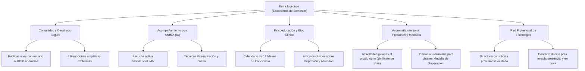
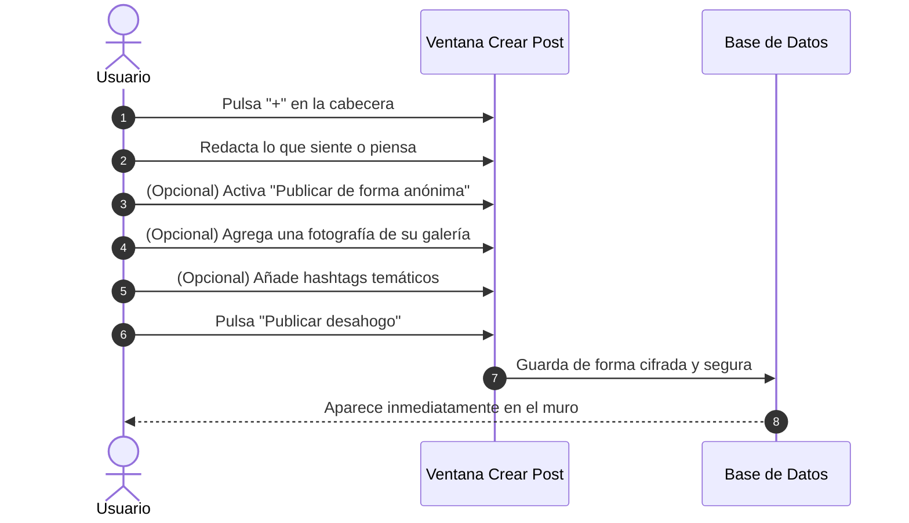
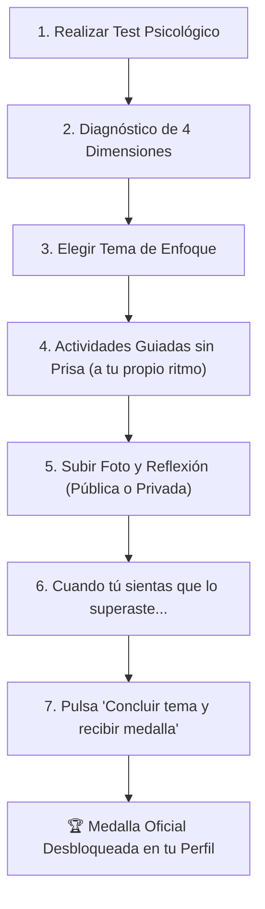

# Entre Nosotros — Descripción del Proyecto y Manual de Usuario

---

# PARTE I: DESCRIPCIÓN DEL PROYECTO

## 1. ¿Qué es Entre Nosotros?
**Entre Nosotros** es una plataforma y aplicación móvil/web de bienestar emocional y salud mental creada para ofrecer un refugio digital seguro, empático, confidencial y libre de juicios. Su misión primordial es acompañar a las personas en momentos de vulnerabilidad, soledad, ansiedad, tristeza, sobrecarga o crecimiento personal, conectándolas con una comunidad respetuosa de apoyo mutuo y con especialistas en psicología clínica debidamente colegiados.

En contraste con las redes sociales convencionales que fomentan métricas de vanidad, comparación o polarización, Entre Nosotros está diseñada bajo una premisa humana: **la validación de lo que sentimos, el respeto a nuestros propios tiempos y la compañía sincera sin presiones.**

---

## 2. Pilares Fundamentales del Ecosistema

1. **Vulnerabilidad Positiva y Respeto Absoluto**: Cada usuario puede expresarse de manera transparente. Las normas comunitarias garantizan cero tolerancia a burlas, discriminación o toxicidad.
2. **Reacciones Empáticas con Significado Real**: Se sustituyeron los "Me gusta" por 4 expresiones de apoyo genuino: *Te Abrazo*, *Te Escucho*, *No Estás Solo* y *Fuerza*.
3. **ANIMA, Asistente Emocional 24/7**: Inteligencia artificial de contención primaria entrenada para escuchar, guiar ejercicios de relajación y activar protocolos de seguridad ante emergencias.
4. **Avance al Propio Ritmo (Sin Plazos Obligatorios)**: Las actividades de apoyo emocional no tienen fechas límite ni contadores forzados de días. El usuario decide cuándo realizarlas y en qué momento concluir para recibir su **Medalla de Superación**.
5. **Vínculo con Especialistas Reales**: Artículos de divulgación clínica redactados por profesionales y acceso directo a psicólogos con cédula profesional verificada.

---

## 3. Identidad Visual y Sensorial
- **Paleta de Colores Terapéutica**: Inspirada en la serenidad y la claridad mental, predominan el **Blanco Puro y el Azul Cielo Pastel** (`#FFFFFF`, `#F0F5F8`, `#E1EAEF`, `#3B708F`, `#223E52`), evitando la sobrecarga sensorial.
- **Tipografía y Proporciones Humanas**: Espacios amplios, botones ergonómicos y tipografía de fácil lectura pensada para momentos de cansancio o sensibilidad visual.
- **Compatibilidad Total**: Experiencia fluida e idéntica en teléfonos móviles (iOS / Android vía Expo) y en computadoras de escritorio mediante la versión web.

---

# PARTE II: MANUAL COMPLETO DE USUARIO

Bienvenido/a a la guía paso a paso de **Entre Nosotros**. A continuación te explicamos detalladamente cada sección, botón, herramienta y flujo que tienes a tu disposición.

---

## ÍNDICE DEL MANUAL
1. [Acceso, Registro y Privacidad de la Cuenta](#1-acceso-registro-y-privacidad-de-la-cuenta)
2. [Estructura de Pantallas y Navegación](#2-estructura-de-pantallas-y-navegación)
3. [Pantalla Principal (Muro Comunitario)](#3-pantalla-principal-muro-comunitario)
4. [Cómo Publicar y Compartir un Desahogo](#4-cómo-publicar-y-compartir-un-desahogo)
5. [ANIMA: Tu Refugio de Escucha y Calma](#5-anima-tu-refugio-de-escucha-y-calma)
6. [Blog: Calendario de 12 Meses y Artículos Clínicos](#6-blog-calendario-de-12-meses-y-artículos-clínicos)
7. [Directorio de Especialistas Clínicos](#7-directorio-de-especialistas-clínicos)
8. [Test Emocional, Actividades al Propio Ritmo y Medallas](#8-test-emocional-actividades-al-propio-ritmo-y-medallas)
9. [Buscador Inteligente y Exploración por Temas](#9-buscador-inteligente-y-exploración-por-temas)
10. [Tu Perfil Personal, Registro de Ánimo y Guardados](#10-tu-perfil-personal-registro-de-ánimo-y-guardados)
11. [Seguridad, Reporte de Contenido y Normas](#11-seguridad-reporte-de-contenido-y-normas)

---

## 1. Acceso, Registro y Privacidad de la Cuenta

### Modo Invitado vs. Usuario Registrado
- **Modo Invitado (Sin Cuenta)**: Al ingresar a la app puedes navegar libremente por el muro, leer las publicaciones comunitarias, explorar los 12 meses del blog, leer artículos de psicólogos y acceder a los números telefónicos de emergencia.
- **Cuenta Registrada (Gratuita)**: Al registrarte desbloqueas todas las interacciones:
  - Crear desahogos propios (públicos o totalmente anónimos).
  - Reaccionar con apoyo a otros miembros.
  - Dejar comentarios afectuosos en las publicaciones.
  - Guardar posts y lecturas en tus marcadores personales.
  - Registrar tu estado de ánimo diario y ver tu progreso semanal.
  - Realizar el test psicológico y avanzar en actividades para desbloquear medallas.
  - Conversar en privado con ANIMA.

### Registro Paso a Paso
1. En la esquina superior derecha, pulsa **"Unirme"**.
2. Ve a la pestaña **"Crear Cuenta"**.
3. Completa los campos:
   - **Nombre de Usuario**: Tu apodo visible dentro de la comunidad (ej. `@alma_en_paz`).
   - **Correo Electrónico**: Para respaldar tu cuenta y recuperar contraseña.
   - **Contraseña**: De al menos 6 caracteres.
4. Consulta y acepta los Términos y Condiciones.
5. Pulsa **"Crear Cuenta"** y tu sesión iniciará automáticamente.

### Recuperación de Contraseña
Si olvidas tu contraseña:
1. En la ventana de inicio de sesión, pulsa **"¿Olvidaste tu contraseña?"**.
2. Introduce tu correo y recibirás un enlace seguro para restablecerla al instante.

---

## 2. Estructura de Pantallas y Navegación

La plataforma cuenta con un sistema de navegación claro y accesible:

- **Barra de Pestañas Inferior (Bottom Tab Bar)**:
  - **Principal**: Muro general, registro diario de ánimo y frase inspiracional.
  - **Buscar**: Exploración por palabras clave, hashtags y temas en tendencia.
  - **ANIMA**: Tu asistente empático con inteligencia artificial.
  - **Blog**: Calendario anual de bienestar y artículos redactados por psicólogos.
  - **Más...**: Menú directo hacia Directorio de Psicólogos, Líneas de Ayuda, Reglas y Perfil.
- **Cabecera Superior (AppHeader)**:
  - Muestra el logotipo oficial de Entre Nosotros.
  - Botón **"+" (Crear Publicación)** para compartir un desahogo con un toque.
  - Avatar personal para acceder rápidamente a tu perfil.
- **Menú Lateral (Drawer)**:
  - Desplegable desde la izquierda para navegar cómodamente a cualquier módulo.

---

## 3. Pantalla Principal (Muro Comunitario)

Es el espacio central de interacción y acompañamiento de la plataforma:

### A. Registro Diario de Estado de Ánimo (*Daily Mood Card*)
Al inicio del muro encontrarás la pregunta: *¿Cómo te sientes hoy?*.
- **Opciones disponibles**:
  - 🤩 **Increíble**: Plenitud y alta energía.
  - 😊 **Bien**: Calma, tranquilidad y balance.
  - 😐 **Neutral**: Un día ordinario, sin emociones intensas.
  - 😔 **Desanimado**: Desgaste leve, tristeza o falta de motivación.
  - 😢 **Mal**: Agobio profundo, dolor emocional o crisis.
- **Respuesta Personalizada**: Tras seleccionar una emoción, la app te presenta una respuesta empática que valida tu sentir y te ofrece contención.
- **Monitoreo Semanal**: Tu respuesta se almacena para alimentar la gráfica de evolución emocional visible en tu perfil.

### B. Frase Inspiracional del Día (*Daily Quote Card*)
Una tarjeta visual diaria con mensajes de autores y terapeutas que invita a la reflexión y al autocuidado consciente.

### C. Publicaciones de la Comunidad
Un flujo continuo de historias y reflexiones compartidas por los usuarios:
- **Publicaciones con Nombre o Anónimas**: Puedes elegir mostrar tu usuario o publicar de forma anónima para preservar tu intimidad.
- **Publicaciones con Insignia de Especialista**: Los psicólogos colegiados aparecen señalados con una insignia azul o verde de **"Psicólogo Oficial"**, compartiendo recomendaciones profesionales.
- **Imágenes**: Fotografías de arte, naturaleza o recuerdos que enriquecen los textos.
- **Hashtags Interactivos**: Etiquetas como `#Desahogo`, `#Superación` o `#Ansiedad` que puedes pulsar para ver publicaciones relacionadas.

### D. Sistema Oficial de las 4 Reacciones de Apoyo
En Entre Nosotros las reacciones transmiten empatía real:

| Reacción | Icono | Propósito Emocional |
| :--- | :---: | :--- |
| **Te Abrazo** | 🤗 *(Corazón / Abrazo)* | Para arropar a quien comparte un dolor o tristeza. |
| **Te Escucho** | 👂 *(Escucha activa)* | Para hacer saber a la persona que su voz es importante. |
| **No Estás Solo** | 🤝 *(Manos unidas)* | Para disipar la sensación de aislamiento en momentos duros. |
| **Fuerza** | 💪 *(Rayo / Energía)* | Para enviar coraje y perseverancia ante los retos. |

- **Cómo reaccionar**:
  - Pulsa una vez para otorgar la reacción rápida (*Te Abrazo*).
  - Mantén presionado el botón por medio segundo para desplegar el selector y elegir entre las 4 opciones.
  - Si vuelves a presionar la reacción activa, se retira de la publicación.

### E. Comentarios y Marcadores
- **Dejar unas palabras**: Pulsa el icono de conversación para brindar palabras de ánimo y apoyo sincero.
- **Guardar**: Pulsa el icono de marcador para añadir el post a tu biblioteca personal privada.

---

## 4. Cómo Publicar y Compartir un Desahogo

Compartir lo que cargas dentro reduce el peso del malestar emocional:

1. **Abrir el editor**: Pulsa el botón **"+"** en la barra superior.
2. **Redactar**: Expresa con tus propias palabras lo que te ocurre, sin preocuparte por la extensión.
3. **Modo 100% Anónimo**:
   - Si se trata de un tema muy delicado, activa el interruptor **"Publicar de forma anónima"**. Tu nombre, foto y enlace de perfil desaparecerán del post; nadie sabrá quién lo escribió.
4. **Adjuntar Foto**: Pulsa el botón de cámara/galería si deseas incluir una imagen representativa.
5. **Etiquetas (#)**: Escribe hashtags para que otros miembros con vivencias similares puedan encontrarte.
6. **Publicar**: Pulsa el botón principal y tu publicación se sumará al muro de la comunidad.

---

## 5. ANIMA: Tu Refugio de Escucha y Calma

**ANIMA** es el asistente emocional interactivo de Entre Nosotros. Diseñado para ofrecer contención primaria, compañía y herramientas prácticas de autorregulación.

### ¿Qué puede hacer ANIMA por ti?
- **Escucha Atenta y Confidencial**: Conversa sobre lo que sientes a cualquier hora; nunca emitirá juicios ni críticas.
- **Ejercicios de Respiración Guiada**: Solicita un ejercicio de respiración consciente (como 4-7-8 o respiración cuadrada) para disminuir palpitaciones o angustia.
- **Reestructuración de Pensamientos**: Te ayuda a ver las situaciones difíciles desde perspectivas más compasivas.

### Botones Rápidos de Bienestar
Al ingresar al chat con ANIMA dispones de atajos inmediatos:
- 🌧️ *Tengo ansiedad*
- 💬 *Necesito hablar*
- 🧘‍♂️ *Ejercicio de respiración*
- ✨ *Consejo positivo*
- 💤 *No puedo dormir*
- 🌱 *Me siento triste*
- 🎯 *Autoestima*
- 💙 *Manejo de estrés*

### Protocolo de Seguridad ante Crisis
> [!IMPORTANT]
> Si durante la conversación con ANIMA expresas ideas de autolesión o emergencia extrema, la aplicación desplegará de forma inmediata el **Banner de Crisis Emocional**, ofreciéndote un botón de llamada directa y gratuita a especialistas en prevención del suicidio y atención psicológica 24 horas.

---

## 6. Blog: Calendario de 12 Meses y Artículos Clínicos

En la pestaña **Blog** confluyen la psicoeducación avalada por profesionales y un mapa anual de autocuidado:

### A. Calendario de Conciencia y Cuidado (12 Meses)
Un carrusel panorámico que resalta un propósito de salud mental para cada mes del año:
- **Enero**: *Nuevos Comienzos y Gratitud*
- **Febrero**: *Amor Propio y Vínculos Sanos*
- **Marzo**: *Resiliencia y Gestión Emocional*
- **Abril**: *Salud Mental en la Infancia y Juventud*
- **Mayo**: *Mes Mundial de la Salud Mental*
- **Junio**: *Diversidad, Identidad y Aceptación*
- **Julio**: *Autocuidado y Descanso Reparador*
- **Agosto**: *Prevención del Burnout y Estrés Laboral*
- **Septiembre**: *Conciencia y Prevención del Suicidio*
- **Octubre**: *Psicoeducación y Ruptura de Estigmas*
- **Noviembre**: *Duelo, Pérdida y Acompañamiento*
- **Diciembre**: *Cierre de Ciclos y Esperanza*

> **Interacción**: Al pulsar sobre cualquier mes, se abre una ventana con el lema, discurso terapéutico y consejos prácticos para esa época del año.

### B. Temas Oficiales: Depresión y Ansiedad
En el Blog cuentas con dos áreas especializadas: **Depresión** y **Ansiedad**.
- **Acceso**: Pulsa sobre la tarjeta de Depresión o de Ansiedad.
- **Cabecera**: Se presenta la fotografía panorámica del tema junto con su título y una breve descripción clínica.
- **Publicaciones de Especialistas**:
  - Cada artículo tiene el formato visual de una publicación principal: foto del psicólogo, nombre, especialidad, cédula validada y fecha.
  - **Consultar al Especialista**: Pulsa en la foto o nombre del psicólogo para abrir su perfil completo y contactarlo.
  - **Texto Completo y Consejos**: Lectura profunda con cajas de recomendaciones prácticas e imágenes adjuntas.
- **Reaccionar y Guardar (Sin Comentarios)**:
  - Puedes otorgar cualquiera de las 4 reacciones de apoyo (*Te Abrazo*, *Te Escucho*, *No Estás Solo*, *Fuerza*) y guardar el artículo en tus marcadores.
  - Por rigurosidad y serenidad de lectura, estos artículos no tienen comentarios abiertos.

---

## 7. Directorio de Especialistas Clínicos

Cuando el desahogo mutuo no es suficiente y requieres atención terapéutica formal, Entre Nosotros te conecta directamente con especialistas verificados:

### Cómo explorar el directorio:
1. En el menú **"Más..."**, selecciona **"Especialistas"**.
2. Utiliza los filtros disponibles:
   - **Especialidad**: Depresión, Ansiedad, Terapia de Pareja, Terapia Infantil, Duelo, etc.
   - **Modalidad**: En línea, Presencial o Ambas.
   - **Búsqueda por texto**: Por nombre del especialista o ciudad.

### Perfil Completo del Psicólogo:
Al pulsar sobre un especialista podrás consultar:
- Fotografía oficial y nombre completo.
- **Cédula Profesional validada** por las autoridades sanitarias.
- Universidad de egreso y enfoque terapéutico (Cognitivo-Conductual, Sistémico, Humanista, etc.).
- Modalidades de atención y ciudad donde atiende.
- **Ubicación en Mapa**: Enlace directo para abrir la dirección en aplicaciones de mapas.
- **Contacto Directo**: Botones para enviar mensaje directo por **WhatsApp** o realizar una llamada telefónica para solicitar informes o agendar una sesión.

---

## 8. Test Emocional, Actividades al Propio Ritmo y Medallas

En la sección de **Ayuda y Soporte** (accesible desde el menú *Más...*):

### A. Test Psicológico de Autoconocimiento
- Un cuestionario breve y amigable con opciones sencillas (*Casi nunca*, *A veces*, *Seguido*, *Mucho hoy*).
- Evalúa 4 dimensiones clave:
  1. **Ánimo y Alegría** (evalúa tristeza o desgano).
  2. **Ansiedad y Calma** (evalúa rumiación o tensión física).
  3. **Estrés y Cansancio** (evalúa sobrecarga del entorno).
  4. **Amor Propio y Confianza** (evalúa relación personal y autoestima).
- Al concluir, recibes un reporte cálido que te orienta sobre qué área de tu vida se beneficiaría de mayor cuidado.

---

### B. Actividades de Acompañamiento: Totalmente a tu Propio Ritmo (Sin Límite de Días)
A diferencia de retos rígidos con contadores forzados:
- **NO existe un límite de días predeterminado**: No son retos de 7 días obligatorios ni tienes que apresurarte.
- **Tú tienes el control del tiempo**: Avanzas cuando tú lo desees y cuando sientas la necesidad de realizar una pausa de autocuidado.
- **Dinámicas interactivas y suaves**: Actividades diseñadas para realizar pequeñas acciones placenteras (ej. escribir una carta de perdón a ti mismo, tomar una fotografía del cielo matutino, ordenar un rincón de tu habitación, dar un paseo sin el celular).
- **Privacidad a tu elección**:
  - Al completar cada actividad puedes subir una foto y una reflexión.
  - Eliges si deseas compartirla en el muro de la comunidad para motivar a otros, o guardarla de forma estrictamente privada solo para ti.

---

### C. Conclusión Voluntaria y Reclamación de tu Medalla
Tú eres quien decide cuándo has alcanzado tu meta personal o cuándo sientes que has superado esa etapa de dificultad:
1. Cuando sientas que recuperaste tu serenidad, bienestar o ánimo, pulsa el botón:
   > **"Concluir tema y recibir medalla"**
2. Inmediatamente el sistema celebrará tu esfuerzo y acreditará de forma permanente tu **Medalla de Superación** en tu perfil personal.
3. Podrás elegir si deseas publicar tu logro en el muro Principal para que la comunidad te felicite con reacciones de apoyo.

#### Las 4 Medallas Oficiales de Superación:

| Tema | Medalla Oficial | Significado y Mérito |
| :--- | :--- | :--- |
| **Depresión** | 🌤️ **Medalla de Luz Interior** | Reconoce tu valentía por reconectar con la energía, la esperanza y el brillo propio paso a paso. |
| **Ansiedad** | 🌿 **Medalla de Calma Mental** | Reconoce tu perseverancia por aprender a respirar, soltar el control y habitar el momento presente. |
| **Estrés** | 🌊 **Medalla de Paz y Equilibrio** | Reconoce tu determinación por poner límites saludables, soltar la sobrecarga y regalarte un respiro. |
| **Amor Propio**| 💙 **Medalla de Amor Propio** | Reconoce tu compromiso por tratarte con compasión, cuidar de ti y celebrar quién eres en autenticidad. |

*(En tu perfil podrás consultar cuántas medallas has obtenido: 0/4, 1/4, 2/4, 3/4 o 4/4).*

---

### D. Líneas de Atención Inmediata en Crisis 24/7
Información oficial de emergencia en México accesible de forma gratuita las 24 horas:
- **Línea de la Vida**: `800 911 2000` (Atención nacional ante crisis severa o riesgo de suicidio).
- **SAPTEL**: `55 5259 8121` (Apoyo y contención psicológica telefónica).
- Cuentas con botones de marcado rápido para llamar con un solo toque sin costo.

---

## 9. Buscador Inteligente y Exploración por Temas

En la pestaña **Buscar**:
- **Buscador en Vivo**: Escribe palabras como *"miedo"*, *"insomnio"*, *"ruptura"* o *"familia"* para leer historias afines y no sentirte solo/a.
- **Filtro por Hashtags**: Descubre las etiquetas más populares de la comunidad.
- **Búsqueda por Usuario**: Localiza a otros miembros escribiendo su identificador con `@`.

---

## 10. Tu Perfil Personal, Registro de Ánimo y Guardados

Al pulsar tu avatar en la barra superior o en el menú:
- **Identidad**: Foto, nombre de usuario y tu biografía personalizada.
- **Contadores de Comunidad**: Muestra cuántas publicaciones has compartido, cuántas reacciones de apoyo has recibido y tu red de personas seguidas / seguidores.
- **Vitrina de Medallas**: Espacio donde se exhiben con orgullo tus **Medallas de Superación** (*Luz Interior*, *Calma Mental*, *Paz y Equilibrio*, *Amor Propio*).
- **Gráfica Semanal de Estados de Ánimo**: Representación visual de cómo han fluctuado tus emociones en los últimos 7 días con base en tus respuestas en el muro principal.
- **Pestaña "Mis Publicaciones"**: Acceso a tus desahogos activos con la posibilidad de editarlos o eliminarlos.
- **Pestaña "Guardados"**: Tu archivo personal de lecturas, artículos y desahogos que decidiste guardar.
- **Cerrar Sesión**: Para salir de tu cuenta de forma segura en cualquier momento.

---

## 11. Seguridad, Reporte de Contenido y Normas

Para que Entre Nosotros continúe siendo un espacio seguro, todos los miembros respetan el siguiente código de convivencia:

> [!CAUTION]
> ### Reglas de Oro de Entre Nosotros:
> 1. **Cero Tolerancia a Burlas e Insultos**: Quien se desahoga abre su corazón. Está estrictamente prohibido juzgar, desestimar el dolor ajeno o proferir comentarios denigrantes.
> 2. **Prohibición de Contenido de Autolesión**: No se permite publicar instrucciones, imágenes ni apología del suicidio o el daño autoinfligido.
> 3. **Confidencialidad y Privacidad**: Respeta los desahogos anónimos. No divulgues datos sensibles de otras personas sin su autorización.
> 4. **No Spam ni Promoción Comercial**: No se permite la venta de productos, esquemas comerciales ni enlaces externos publicitarios.

### Cómo Reportar una Publicación:
Si detectas un comentario o publicación que viole estas reglas:
1. Pulsa el botón de tres puntos **"..."** situado en la parte superior derecha del post.
2. Selecciona **"Reportar publicación"**.
3. El contenido será derivado de forma inmediata al equipo de moderación para su evaluación y retiro si corresponde.

---

*Entre Nosotros — Una comunidad donde cada emoción cuenta, sin presiones y a tu propio ritmo.*
